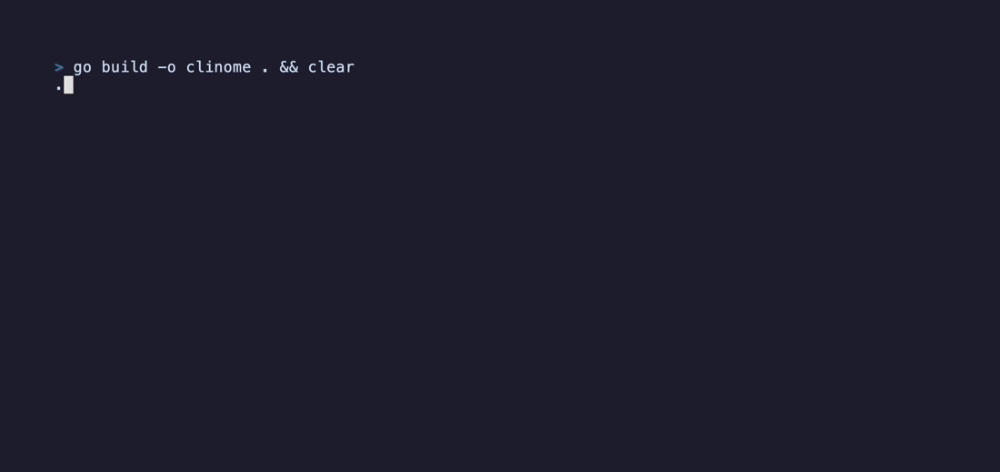

# clinome

[](https://github.com/altf2o/clinome/actions/workflows/ci.yml)
[](https://pkg.go.dev/github.com/altf2o/clinome)
[](LICENSE)

A terminal metronome with a full-screen TUI, built with
[Bubble Tea](https://github.com/charmbracelet/bubbletea) and
[oto](https://github.com/ebitengine/oto).


- Large beat display that scales to the terminal size, with a beat indicator
  row and an accent flash on the downbeat
- 60 built-in click sounds, each with a high (accent) and low variant, with
  a picker that previews each sound as you browse
- Sample-accurate timing: beats are scheduled in the audio stream, not with
  timers
- Adjustable tempo, tap tempo, time signature, accent and volume

## Installing

Download a binary for macOS, Linux or Windows from the
[releases page](https://github.com/altf2o/clinome/releases), or install
with Go 1.25 or newer:

```sh
go install github.com/altf2o/clinome@latest
```

## Building

Requires Go 1.25 or newer (the version in `go.mod`).

```sh
go build -o clinome .
go test ./...
```

The sounds in `Metronomes/` are embedded in the binary, so it runs from any
directory.

On Linux, audio goes through ALSA (`libasound.so.2`, loaded when the program
starts; no development headers are needed to build). It works with
PipeWire and PulseAudio through their ALSA compatibility layers. If it isn't
installed, install `libasound2` (Debian/Ubuntu) or `alsa-lib`
(Fedora/Arch). macOS and Windows use their native audio APIs. No cgo is
needed on any platform, so cross-compiling just works.

## Usage

```sh
./clinome                                # 120 BPM, 4/4
./clinome -bpm 90 -beats 3               # 3/4 waltz at ♩ = 90
./clinome -bpm 120 -beats 6 -unit 8      # 6/8, clicking eighth notes
./clinome -sound Synth_Sine_A            # pick the starting sound
./clinome -list                          # print available sound names
./clinome -sounds ~/my-clicks            # use your own sound files
```

### Options

| Flag | Default | Description |
| --- | --- | --- |
| `-bpm` | `120` | Starting tempo in quarter notes per minute (20–300) |
| `-beats` | `4` | Beats per bar, the time signature numerator (1–16) |
| `-unit` | `4` | Beat unit, the time signature denominator: `1`, `2`, `4`, `8` or `16` |
| `-sound` | `Perc_MetronomeQuartz` | Starting sound (see `-list`) |
| `-sounds` | built-in | Directory of sound files to use instead of the built-in set |
| `-latency` | `50ms` | Delay the beat display so it lines up with the audio (0s–1s) |
| `-list` | | List available sound names and exit |
| `-version` | | Print the version and exit |

### Tempo and time signature

BPM is always measured in quarter notes, and the metronome clicks once per
beat-unit note. At ♩ = 120:

| Meter | Clicks per minute |
| --- | --- |
| 4/4 | 120 |
| 2/2 | 60 |
| 6/8 | 240 |
| 6/16 | 480 |

When the beat unit isn't a quarter note, the tempo card shows the actual
click rate. Tap tempo treats your taps as clicked beats, so tapping eighth
notes in 6/8 at 240 per minute sets ♩ = 120.

## Key bindings

### Main screen

| Key | Action |
| --- | --- |
| `space` | Start / stop |
| `↑` `k` `+` | Tempo +1 |
| `↓` `j` `-` | Tempo −1 |
| `→` `l` | Tempo +5 |
| `←` `h` | Tempo −5 |
| `PgUp` / `PgDn` | Tempo ±10 |
| `t` | Tap tempo (averages up to the last 6 taps; resets after a 2 s pause) |
| `]` / `[` | Beats per bar +1 / −1 |
| `}` / `{` | Beat unit up / down (1 → 2 → 4 → 8 → 16) |
| `a` | Toggle accent (high click on beat 1) |
| `s` `enter` | Open the sound picker |
| `p` | Preview the current sound |
| `.` `>` / `,` `<` | Volume +10% / −10% |
| `q` `esc` `ctrl+c` | Quit |

### Sound picker

Moving the cursor plays a preview of that sound: the high click followed by
the low click.

| Key | Action |
| --- | --- |
| `↑` `k` / `↓` `j` | Previous / next sound |
| `PgUp` / `PgDn` | Page up / down |
| `home` `g` / `end` `G` | First / last sound |
| `p` `tab` | Replay the preview |
| `enter` | Select the sound and close the picker |
| `esc` `s` `q` | Close the picker without changing the sound |
| `space` | Start / stop, to hear the sound in context |
| `ctrl+c` | Quit |

## Custom sounds

Point `-sounds` at a directory of WAV files named `NAME_hi.wav` and
`NAME_lo.wav`. The high file plays on the accented downbeat and the low file
on the other beats (and on every beat when accent is off). If only one half
of a pair exists, it is used for both.

Names are split at the first underscore into a group and a label for
display, so `Synth_Sine_A_hi.wav` appears as **Synth · Sine A**.

Supported formats: 16-, 24- or 32-bit integer PCM and 32-bit float, mono or
stereo, at any sample rate (resampled to 48 kHz).

## Tuning the display sync

The beat display is delayed by 50 ms by default so it lines up with what
you hear. If the flash looks early or late on your system, adjust it with
`-latency`. Bluetooth headphones often need 150–250 ms:

```sh
./clinome -latency 200ms
```

## How it works

Most of the interesting code is in `engine.go`, which is short enough to
read in one sitting.

- **Timing in the sample domain.** `Engine` is an `io.Reader` that the audio
  player pulls PCM from. `Read` keeps a running frame counter and, while
  filling each buffer, starts a click voice on the exact frame where a beat
  is due (`trigger`). Timers and goroutine scheduling never decide when a
  click sounds, so there's no drift or jitter, whatever the buffer size.
- **Tempo changes without stutter.** `retime` schedules the next beat
  relative to the previous one, so changing BPM mid-bar takes effect on the
  very next click.
- **Mixing.** Each click is a `voice` with a frame position and an optional
  start delay. Voices are summed, scaled by volume and clamped. The sound
  picker's preview is two voices (hi, then lo after 350 ms) that are cut off
  when you move to the next sound.
- **Keeping the UI in sync.** When a beat is scheduled, the engine works out
  how far into the buffer it falls, adds the output latency, and sends the
  UI a message via `time.AfterFunc` at that moment. Each `Start` bumps a
  generation number so beat messages still in flight from before a
  stop/start are ignored.
- **The UI** (`ui.go`) is a standard [Bubble Tea](https://github.com/charmbracelet/bubbletea)
  model. The big digits come from a 3×5 pixel font in `font.go`, scaled to
  fit the terminal.
- **WAV decoding** (`wav.go`) is a small standalone RIFF parser with linear
  resampling. It's fuzz-tested, because `-sounds` loads arbitrary files.

## Contributing

See [CONTRIBUTING.md](CONTRIBUTING.md).

## License

The code is released under the [MIT License](LICENSE). The sounds in
`Metronomes/` are CC0 (see below).

## Credits

Metronome sounds recorded by Ludwig Peter Müller (December 2020), released
under [CC0 1.0 Universal](https://creativecommons.org/publicdomain/zero/1.0/).
See `Metronomes/Credits.txt`.
